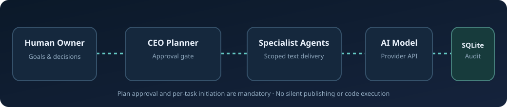
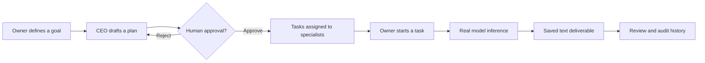
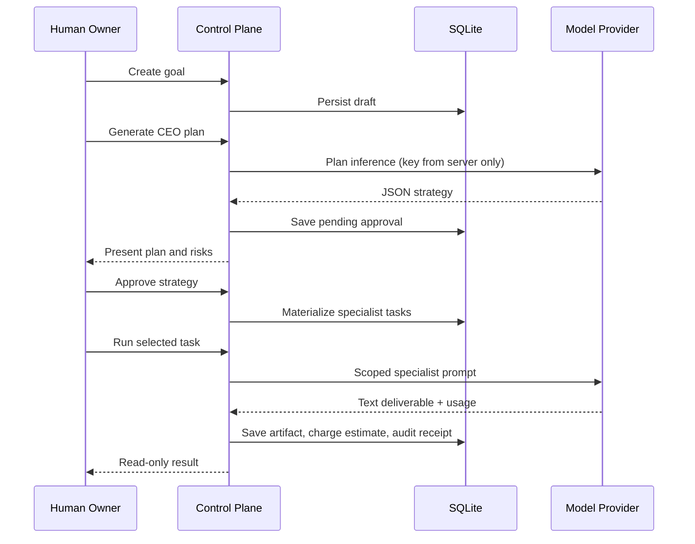

<div align="center">

# SPYDR by Falvorn AI

### An AI CEO and command center for your autonomous workforce

**One intelligence. An entire AI workforce.**

Coordinate strategy, delegate specialist work, control costs, and inspect every result.




[Quick start](#quick-start) · [Actual capabilities](#what-is-implemented) · [Security](#security-and-boundaries) · [Configuration](#configuration) · [Tests](#quality-and-verification) · [Roadmap](docs/ROADMAP.md)

</div>

---

## Overview

> **Product:** SPYDR by Falvorn AI · **AI CEO:** SPYDR Core · **Agent network:** SPYDR Web · **Dashboard:** SPYDR Command Center.
>
> GitHub: [hossain0707/Falvorn-SPYDR-CEO](https://github.com/hossain0707/Falvorn-SPYDR-CEO)

**Scope:** A real local-first AI agent control plane, not a fully autonomous employee replacement or a browser-driving robot. Autonomous third-party actions and a photorealistic 3D spider UI are future enhancements, not current features.


SPYDR by Falvorn AI is a focused, **fully runnable, local-first control plane** for a single owner to manage a virtual company of specialist AI agents. Give the CEO a strategic goal, review its proposed plan, then explicitly run individual specialist tasks and inspect generated text deliverables. Persistent records capture tasks, decisions, model usage, and audit events.

It is intentionally narrower than a fully autonomous workforce system. It **does not execute source code, clone repositories, browse sites, make purchases, publish content, or push to GitHub**. Its agents generate real model-backed text deliverables, not simulated external actions. Those boundaries prevent the dashboard from promising outcomes it cannot verify.

### How the product works



## What is implemented

| Capability | Implementation | Status |
|:---|:---|:---|
| Secure initial workspace setup | Single-owner account, salted scrypt, expiring sessions | Implemented |
| Dashboard | Responsive UI with real SQLite-backed metrics and activity | Implemented |
| CEO planning | OpenAI-compatible API and strict structured strategy validation | Implemented |
| Manual planning | Human-authored tasks when no AI key is available | Implemented |
| Human approval | Explicit approve/reject workflow before task creation | Implemented |
| Specialist agents | CEO, Engineering, Research, Marketing, Design, Quality, Operations | Implemented |
| Task execution | Per-task authenticated inference yielding saved Markdown/text | Implemented |
| Spending | Recorded input/output token usage and preflight budget checks | Implemented (estimated) |
| Governance | CSRF protection, explicit task initiation, hashed audit chain | Implemented |
| Deployment | Docker/Compose and direct Python launch | Implemented |
| Testing | Python integration suite, JS parse checks, CI workflow | Implemented |
| Autonomous coding or external actions | Shell/browser/remote Git integrations | **Not implemented** |
| Multi-tenant enterprise SSO | Teams, org policy, enterprise RBAC | **Not implemented** |

> **Practical distinction:** The system makes real model calls only when configured with `AI_API_KEY`. An empty dashboard reflects an empty database. There are no fabricated active tasks or pre-populated usage numbers.

## Quick start

### Option A — Python, no production packages to install

Requires Python 3.13 or newer. From this repository root:

```bash
cp .env.example .env
# Edit .env; provide AI_API_KEY and an API-compatible model when available.
set -a
. ./.env
set +a
python -m agentcompany
```

Open **http://127.0.0.1:8787** and create an owner account with a strong password. The app defaults to loopback-only operation.

On Windows PowerShell, set environment variables with `$env:AI_API_KEY = "..."` and start `python -m agentcompany`.

### Option B — Docker Compose

```bash
cp .env.example .env
# Configure AI_API_KEY in the untracked .env if AI execution is needed.
docker compose up --build -d
docker compose ps
```

Open **http://127.0.0.1:8787**. SQLite data lives in the persistent named volume `company_data`.

**Do not publish this HTTP port directly to the public internet.** Put it behind a properly configured HTTPS reverse proxy and an access-control layer, or keep it private.

## First company mission

1. Create a workspace and owner password. Seven role-based agent records are created (none is running yet).
2. Select **New goal** and enter the objective, constraints, and expected outcome.
3. Select **Create plan**. Choose an AI-generated plan if a provider key is configured, or compose a manual plan without a key.
4. Open **Approvals** and inspect proposed deliverables, roles, estimates, and risks. Approve or reject.
5. Open **Goals & tasks** and explicitly run each ready task. The specialist produces a saved text/Markdown artifact using your configured model.
6. Review the artifact, recorded model spend, and events in **Activity log**. Verify the audit chain from the UI.

### Example goal

> Design a customer support workspace for a small business. Produce a secure architecture, accessible UX flows, a quality assurance checklist, privacy considerations, and measurable acceptance criteria. Keep the initial plan below a modest AI-token budget. Do not claim deployment.

This example is guidance for the form, not a claimed completed run.

## Architecture

```text
Falvorn-SPYDR-CEO/
├── agentcompany/
│   ├── __main__.py         # Application entrypoint
│   ├── config.py           # Explicit environment configuration
│   ├── db.py               # SQLite schema, transactions, audit chain
│   ├── model.py            # OpenAI-compatible inference, plan validation
│   ├── security.py         # Password hashes and session management
│   └── server.py           # Authenticated HTTP API and workflows
├── web/
│   ├── index.html          # Owner dashboard shell
│   ├── app.js              # Live data and interaction handlers
│   └── styles.css          # Responsive design system
├── tests/test_core.py      # API, approval, execution, audit integration tests
├── scripts/check.py       # Dependency-free prepush checks
├── docs/
│   ├── architecture.svg
│   ├── SECURITY.md
│   ├── ROADMAP.md
│   └── UPSTREAM_INTEGRATION.md
├── .github/workflows/quality.yml
├── Dockerfile
├── compose.yaml
└── .env.example
```

### Data flow and trust boundary



## Configuration

All secrets stay on the server; none are stored in your dashboard's source code or SQLite database.

| Environment variable | Default | Meaning |
|:---|:---|:---|
| `APP_HOST` | `127.0.0.1` | Loopback is safest |
| `APP_PORT` | `8787` | HTTP listen port |
| `APP_DB` | `./data/agentcompany.sqlite3` | Persistent local database |
| `AI_API_KEY` | Empty | Required for live planning and execution |
| `AI_BASE_URL` | `https://api.openai.com/v1` | OpenAI-compatible inference endpoint |
| `AI_MODEL` | `gpt-4.1-mini` | Model identifier; must exist at provider |
| `AI_INPUT_PER_MILLION_USD` | `0.40` | Estimated cost per million input tokens; update to actual rate |
| `AI_OUTPUT_PER_MILLION_USD` | `1.60` | Estimated cost per million output tokens; update to actual rate |
| `DEFAULT_MONTHLY_BUDGET_USD` | `10` | Initial preflight spending allowance |
| `AI_REQUEST_TIMEOUT_SECONDS` | `60` | Model request timeout |
| `APP_HTTPS` | `0` | Set to `1` only for fully HTTPS-fronted deployment |

Not every provider supports the same authentication or request parameters. Run one live call with your chosen provider before treating it as compatible.

### API entrypoints

| Verb | Route | Purpose |
|---|---|---|
| `GET` | `/healthz` | Liveness check |
| `POST` | `/api/setup` | First owner/workspace creation |
| `POST` | `/api/login` | Establish owner session |
| `GET` | `/api/state` | Workspace agents, goals, approvals, runs, audit |
| `POST` | `/api/goals` | Create a goal |
| `POST` | `/api/goals/{id}/plan` | Model-backed CEO plan |
| `POST` | `/api/goals/{id}/manual-plan` | Human-authored plan |
| `POST` | `/api/approvals/{id}/decision` | Approve or reject |
| `POST` | `/api/tasks/{id}/run` | Execute one specialist task |
| `PATCH` | `/api/company` | Update spending cap |
| `GET` | `/api/audit/verify` | Verify SHA-256 audit chain |

Mutations require an authenticated cookie and CSRF header after sign-in.

## Security and boundaries

The app uses a local-owner account, a scrypt password hash, HttpOnly SameSite session cookies, CSRF checks, restrictive CSP and other browser security headers, parameterized SQL, and approval-gated execution. The audit chain helps detect edits; it is not remotely anchored or immutable. Cost checks are **estimates and cannot guarantee a hard spending cap**. Set a billing ceiling with your inference provider separately.

Read [the security and operating limitations](docs/SECURITY.md) before exposing any instance to other users.

## Quality and verification

```bash
python scripts/check.py
python -m pytest -q
node scripts/ui_logic_check.mjs
```

The core app needs **no pip dependencies**. The test suite needs `pytest` (`python -m pip install pytest`). CI checks Python and JavaScript syntax, renders all six dashboard views using a DOM shim, and runs integration tests without a paid API provider.

A test-stub inference client is used **only in tests**. Production inference never silently falls back to a fake response.

**Verification status:** API integration tests pass locally. Live external provider credentials and public TLS deployment were not available for this package; those must be validated before an internet-facing production release.

## Relationship to the source inspiration and upstream ecosystem

The Instagram reel describes a CEO agent that plans and delegates across a virtual company. [Paperclip](https://github.com/paperclipai/paperclip) is a strong match to the described open-source workflow, but the reel caption does not provide the repository URL directly. Paperclip is an existing, mature MIT-licensed project that already has extensive agent orchestration, scheduling, approvals, and cost accounting.

This codebase is a **separate, original focused implementation**, not a fork or a full rewrite of Paperclip. It emphasizes small deployment footprint, text-only execution boundaries, budget visibility, a straightforward owner UI, and a provable local workflow. We do **not** claim it is universally better than Paperclip. See [upstream integration considerations](docs/UPSTREAM_INTEGRATION.md) for the route to a genuine Paperclip fork if desired.

## Development and distribution

- Source: Python 3.13 + HTML/CSS/vanilla JavaScript + SQLite.
- Runtime footprint: no Python production packages or frontend build step.
- Hosting: local machine, private VM, or container with TLS reverse proxy.
- GitHub: standard `main` branch recommended, CI included. There is no automated GitHub push functionality.
- Cost: core software runs free; model inference may incur provider charges.
- Roadmap: [v1.1 and v2 plans](docs/ROADMAP.md) are explicitly listed separately from implemented features.

## License

MIT © 2026 Md Najmul Hossain. See [LICENSE](LICENSE). This license covers the new code in **this** repository; it does not transfer ownership of the independent upstream Paperclip project. The Paperclip repository retains its own MIT license and copyright.
